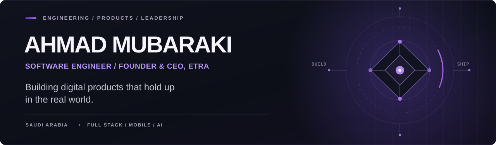

<!-- Profile README for github.com/ALxxy123 -->

  

  

    <a href="https://ahmedmobarki.me"><strong>Portfolio</strong></a>
    &nbsp; · &nbsp;
    <a href="https://www.linkedin.com/in/ahmed-mubarki-7874232b8/">LinkedIn</a>
    &nbsp; · &nbsp;
    <a href="https://x.com/ahmdalnt98">X / Twitter</a>
    &nbsp; · &nbsp;
    <a href="https://etra.sa">ETRA</a>
  

### About me

I'm a **software engineer and product builder** based in Saudi Arabia. I work across architecture, full-stack and mobile development, AI integration, and the infrastructure needed to take an idea from prototype to a product people can actually use.

I'm also the **Founder & CEO of [ETRA](https://etra.sa)**, where I lead the development of technology-driven products and learning experiences. My work combines hands-on engineering, product decisions, and technical leadership.

> I care about what happens *after* the code works: maintainability, security, performance, and the ability to keep shipping.

### Selected work

| Project | What I built / work on | Focus |
| :--- | :--- | :--- |
| **[ETRA Platform](https://etra.sa)** | A live platform supporting technical learning programs, subscriptions, and operational workflows. The application source is private. | Product engineering · Web · Backend |
| **[Satr](https://github.com/ALxxy123/Satr)** | A local-first TypeScript SDK and CLI that detects, redacts, and blocks sensitive data before it reaches AI services. **Beta / open source.** | TypeScript · AI security · Developer tools |
| **[ETRA Creators Portal](https://github.com/ALxxy123/etra-creators-portal)** | An Arabic-first application and review portal with submission tracking, CV uploads, and an admin dashboard. | Next.js · PostgreSQL · Supabase |
| **[code-scan-sec](https://github.com/ALxxy123/code-scan-sec)** | A security scanning tool covering secrets detection, repository scanning, and vulnerability checks. | Python · AppSec · Automation |

### Engineering toolkit

| | Technologies |
| :--- | :--- |
| **Frontend** | TypeScript · JavaScript · React · Next.js · Vue.js |
| **Backend & APIs** | Node.js · NestJS · Laravel · REST APIs |
| **Mobile** | Flutter · Dart · Kotlin |
| **Data** | PostgreSQL · MySQL · MongoDB · Redis |
| **AI & automation** | Python · LLM integrations · Developer tooling |
| **Infrastructure** | Docker · Linux · Cloudflare · GitHub Actions |

### What I focus on

- **Architecture that lasts** — practical system design, clear boundaries, and long-term maintainability.
- **Product-minded development** — balancing user experience, delivery speed, security, and cost.
- **Shipping and operating** — from implementation and testing to deployment and real-world iteration.

### Building at ETRA

Beyond the code, I'm building an ecosystem around technical enablement and digital products:

**[ETRA](https://etra.sa)** — technical education, practical bootcamps, and learning experiences.  
**[ETRA Tech](https://etratechs.com/)** — technology solutions and product development for businesses.

---

  <strong>Have a product to build or a technical problem worth solving?</strong>
  

    <a href="https://ahmedmobarki.me">Explore my work</a>
    &nbsp; · &nbsp;
    <a href="https://www.linkedin.com/in/ahmed-mubarki-7874232b8/">Let's connect</a>
  

  Made to reflect the work — not just the stack.

